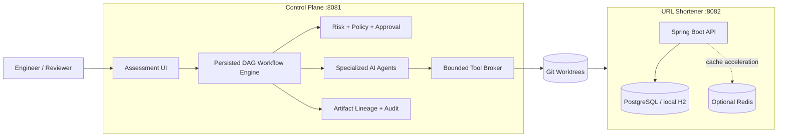
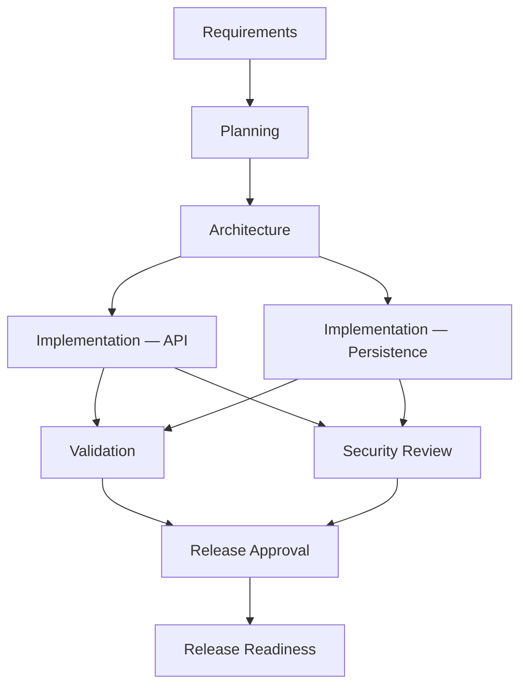

# AI-Assisted SDLC Control Plane — URL Shortener Assessment

This repository is a working prototype of an **engineer-led SDLC workflow accelerated by AI**. The URL shortener is the application under change; the control plane coordinates requirement analysis, planning, implementation, validation, security review, approvals, and release-readiness evidence around that application.

The system is intentionally **not** an autonomous software factory. Model output is treated as a proposal. Deterministic workflow logic, policy checks, bounded tools, tests, and human approval retain authority over what is allowed to happen.

> **Design principle:** AI can reason and propose. Tools perform bounded actions. Policy decides what is allowed. Evidence determines whether work is acceptable. Engineers own the final decision.

## What this project demonstrates

The assessment is centered on engineering judgment rather than raw model autonomy:

- requirement interpretation with an explicit clarification stop when intent is materially ambiguous;
- a persisted DAG with sequential, parallel, and fan-in execution;
- specialized agents for requirements, planning, architecture, implementation, validation, security, and release readiness;
- deterministic risk classification and approval gates outside the model;
- least-privilege tool execution against isolated Git worktrees;
- bounded retries and failure classification;
- versioned artifacts, lineage, and selective replanning when an upstream decision changes;
- audit and reliability evidence for model calls, tool executions, approvals, retries, and workflow state;
- a realistic Java/Spring Boot URL-shortener target with persistence, optional cache acceleration, idempotency, lifecycle handling, analytics, and tests.

## Repository layout

```text
.
├── control-plane/              # SDLC workflow/orchestration service — port 8081
├── url-shortener/              # Application being changed — port 8082
├── scripts/                    # Local setup, run, and demo helpers
├── observability/              # Prometheus/Grafana configuration
├── docs/
│   ├── ARCHITECTURE.md         # Deeper design and trust-boundary notes
│   └── TESTING.md              # Test strategy, limitations, and trade-offs
├── docker-compose.demo.yml     # Complete evaluator stack
├── Dockerfile.control-plane
├── Dockerfile.url-shortener
└── pom.xml                     # Java 21 multi-module Maven build
```

## Run locally

### Prerequisites

For the non-Docker path:

- Java 21
- Maven 3.9+
- Git
- PostgreSQL 16+

For the full demo stack, Docker with Compose is sufficient in addition to Git.

### Option 1 — full demo with Docker

This is the simplest evaluator path because it starts PostgreSQL, Redis, both applications, Prometheus, and Grafana together.

```bash
./scripts/bootstrap-local-repo.sh
docker compose -f docker-compose.demo.yml up --build
```

Open:

| Service | URL | Purpose |
|---|---|---|
| Control plane | http://localhost:8081 | Primary assessment UI and workflow evidence |
| URL shortener | http://localhost:8082 | Target application UI/API |
| Prometheus | http://localhost:9090 | Metrics |
| Grafana | http://localhost:3000 | Dashboard (`admin` / `admin`, local demo only) |

Stop and remove local demo state with:

```bash
docker compose -f docker-compose.demo.yml down -v
```

### Option 2 — macOS/local run without Docker

Install the local dependencies:

```bash
brew install openjdk@21 maven postgresql@16
brew services start postgresql@16
```

Create the control-plane database and role:

```bash
./scripts/setup-local-postgres.sh
```

Optional environment check:

```bash
./scripts/preflight.sh
```

Start the two applications in separate terminals.

**Terminal 1 — control plane**

```bash
./scripts/run-control-plane-local.sh
```

**Terminal 2 — URL shortener**

```bash
./scripts/run-url-shortener-local.sh
```

Then open `http://localhost:8081`.

The control plane always uses PostgreSQL because workflow state, approvals, audit events, artifact lineage, and replanning need durable transactional state. The local URL-shortener path intentionally defaults to embedded H2 with caching disabled so the target application can be exercised without additional infrastructure.

If the project was extracted from a ZIP rather than cloned from Git, `run-control-plane-local.sh` creates a local baseline commit automatically. The control plane needs a real Git checkout because implementation work is isolated with Git worktrees.

### Optional — run the URL shortener against PostgreSQL

After `setup-local-postgres.sh` has run:

```bash
./scripts/run-url-shortener-postgres.sh
```

Redis remains optional in this path. PostgreSQL is still the source of truth.

## First evaluator walkthrough

A useful first pass is deliberately short:

1. Open `http://localhost:8081` and confirm that the target system is healthy.
2. Run the **Greenfield** scenario to see decomposition, parallel implementation branches, validation/security fan-in, and approval gates.
3. Run the **Ambiguous** scenario and confirm that planning stops until a human resolves the requirement ambiguity.
4. Inspect workflow evidence: approvals, audit events, model invocations, tool executions, artifacts, and reliability metrics.
5. Open `http://localhost:8082` only when you want to exercise the target application directly.

The control plane is the primary assessment surface. The URL shortener exists to make the engineering workflow concrete rather than hypothetical.

## Architecture



The two Spring Boot runtimes are separated because they have different trust and failure boundaries:

- **Control plane:** decides workflow state, invokes agents, enforces policy, records approvals/evidence, and constrains engineering tools.
- **URL shortener:** the application being inspected and modified by the workflow.

This separation prevents model-driven engineering actions from becoming the workflow authority themselves.

### Workflow graph



The API and persistence branches may execute independently after architecture. Validation and security wait for both implementation branches, then release readiness waits for both evidence paths.

### Governance boundary

Risk is calculated in deterministic Java code from node type and change impact. It is not inferred from model confidence.

| Risk | Default policy |
|---|---|
| Low / Medium | May proceed within the agent's capability envelope |
| High | Requires one independent human approval |
| Critical | Requires two independent human approvals |
| Direct production mutation | Denied |

The agent capability model also denies unrestricted shell access, writes to the main checkout, Git push, and production deployment. Agents can request a tool action; the Tool Broker independently checks whether that action is authorized before executing it.

## Assessment scenarios

### Greenfield — single-use links

Adds a new capability while preserving existing link behavior. The interesting engineering problem is concurrency: a single-use link must allow exactly one successful consume even when redirects race. The scenario exercises requirement decomposition, API/data-model reasoning, parallel implementation, regression evidence, and release governance.

### Brownfield — redirect correctness under cache degradation

Starts from an existing behavior and requires repository reasoning before modification. PostgreSQL remains authoritative; Redis is only an optimization. The intended outcome is the smallest safe change that prevents stale cache state from resurrecting expired or deactivated links while preserving redirect availability during cache degradation.

### Ambiguous — enterprise link security

The requirement is intentionally underspecified. The correct behavior is to stop before planning, surface the ambiguity, capture an authoritative human decision, version the requirement artifact, and replan only the affected downstream work. This scenario demonstrates that useful AI assistance includes knowing when not to code.

## Model runtime

The default provider is `deterministic`. That is intentional: evaluation and CI should be reproducible and should not depend on external credentials, network availability, rate limits, or model drift.

A live OpenAI-compatible Responses adapter is also implemented behind the same `ModelGateway` interface. To use it locally:

```bash
export MODEL_PROVIDER=openai-responses
export OPENAI_API_KEY=...
export OPENAI_MODEL=...
./scripts/run-control-plane-local.sh
```

The orchestration and governance model does not change when the model provider changes. A live model still cannot approve its own work or bypass deterministic policy/tool checks.

## URL-shortener API

The product can be exercised independently of the control plane.

Create a short URL:

```bash
curl -i -X POST http://localhost:8082/api/v1/urls \
  -H 'Content-Type: application/json' \
  -H 'Idempotency-Key: demo-001' \
  -d '{"url":"https://example.com/docs","customAlias":"staffdemo"}'
```

Redirect:

```bash
curl -i http://localhost:8082/r/staffdemo
```

Analytics:

```bash
curl http://localhost:8082/api/v1/urls/staffdemo/analytics
```

Deactivate:

```bash
curl -i -X DELETE http://localhost:8082/api/v1/urls/staffdemo
```

Or run the bundled smoke flow:

```bash
./scripts/demo-url-shortener.sh
```

## Testing

Fast local verification:

```bash
mvn test
```

Full verification on a Docker-capable machine:

```bash
mvn clean verify
docker compose -f docker-compose.demo.yml config --quiet
```

`mvn clean verify` includes the Failsafe/Testcontainers integration path for PostgreSQL and Redis. GitHub Actions runs the same Maven verification, validates the demo Compose file, and builds both application images.

The test strategy deliberately separates **model-influenced execution** from **trusted integration verification**. Agent tools can run bounded build/test operations, but the Docker daemon is not exposed as an agent capability. Containerized integration tests belong in the trusted CI/evaluator boundary.

See [`docs/TESTING.md`](docs/TESTING.md) for test layers, prototype limitations, and trade-offs.

## Key engineering decisions

A few choices are intentionally conservative:

- **PostgreSQL for control-plane state.** Workflow state, approvals, audit history, and artifact lineage benefit from transactions and concurrency guarantees.
- **Database as URL source of truth.** Redis is optional acceleration; cache failure must not determine correctness.
- **No Kafka.** The prototype does not have a demonstrated throughput, replay, or independent-consumer requirement that justifies a broker.
- **Custom workflow engine for the assessment.** It keeps scheduling, gates, retries, and replanning visible. A production platform should evaluate Temporal, Camunda, or another mature workflow engine once scale and operational requirements justify that dependency.
- **No autonomous deployment.** The workflow produces release-readiness evidence. Deployment remains outside the agent capability boundary.
- **Reproducible model default.** Deterministic mode proves the orchestration contract without making the demo depend on an external model provider.

More detail is in [`docs/ARCHITECTURE.md`](docs/ARCHITECTURE.md).

## Known prototype constraints

This is an assessment prototype, not a production control plane. The main gaps are explicit:

- orchestration runs in a single control-plane process; durable state survives restart, but there is no distributed scheduler/leader election;
- policy is implemented in code rather than an external policy engine such as OPA;
- Git worktrees are local rather than ephemeral remote sandboxes;
- compensation demonstrates orchestration semantics, but real rollback behavior is operation-specific;
- deterministic model mode validates the integration contract, not model quality;
- authentication/authorization for a multi-tenant production control plane is outside this prototype's scope.

Those constraints are deliberate trade-offs to keep the assessment focused on the core problem: **how to use AI to accelerate engineering while keeping authority, evidence, and risk control with the engineering system and its human reviewers.**
